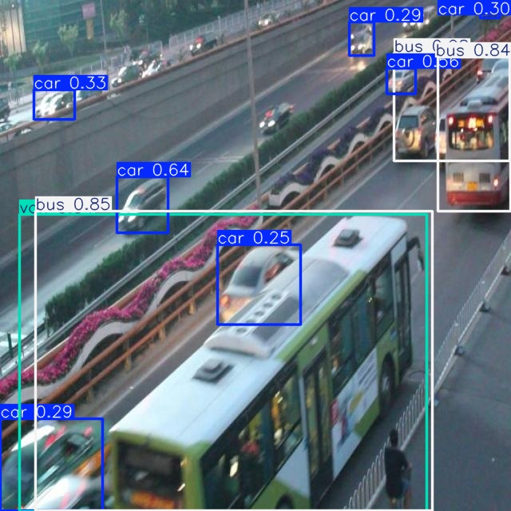
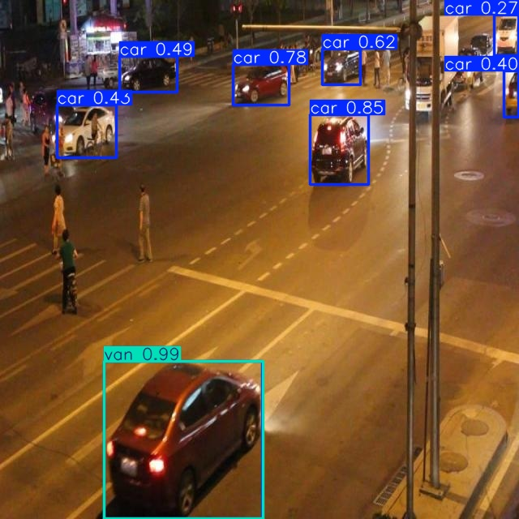

# Báo cáo cá nhân — Ngày 2 Object Detection

## 1. Thông tin học viên

- Họ tên: Nguyễn Thanh phong
- MSSV: 2A202603119
- Email: phongtrieu2048@gmail.com. (26ai.phongnt5@vinuni.edu.vn)
- Lớp: 2A-LAB-E402
- Link repo bài làm: https://github.com/Tphong27/K5-L2-DAY02-NguyenThanhPhong-2A202603119-ObjectDetection.git
- Link Colab đã chạy: https://colab.research.google.com/github/Tphong27/K5-L2-DAY02-NguyenThanhPhong-2A202603119-ObjectDetection/blob/main/notebooks/day2_annotation_to_yolo.ipynb#scrollTo=ol8zYYzz40Ta

## 2. Schema và mini guideline

Chi tiết ở [GUIDELINE_MINI.md](../../GUIDELINE_MINI.md). Đã áp dụng schema bốn lớp car=0, truck=1, bus=2, van=3. Xe đỗ, bị che hoặc bị cắt khung vẫn gán theo phần nhìn thấy; không gán người, mô tô/xe máy, biển báo.

Ba ca mơ hồ:

- `drive_024`: xe nhỏ ở xa, bị che phần dưới, khó phân biệt car/van → giữ `van`.
- `drive_035`: xe đỗ bị cột trạm và người che → giữ `car`, một box quanh phần nhìn thấy.
- `drive_047`: xe bị cắt rìa trái, hình dáng giống minivan → giữ `van`.

Cần giảng viên làm rõ: ranh giới car/van với minivan (ca `drive_024`, `drive_047`).

## 3. Annotation và self-QC

- Số file nhãn train: 50
- Kết quả checker và lỗi đã xử lý: ĐẠT cấu trúc: 50/50 file nhãn hợp lệ
- Danh sách ít nhất 10 ảnh đã rà bằng mắt: drive_001, drive_002, drive_007, drive_013, drive_024, drive_029, drive_035, drive_037, drive_041, drive_047.
- Lỗi bỏ sót/box/class phát hiện khi rà và cách sửa: Gắn sai label car cho van ở drive_007 và đã sửa thủ công lại.
- Commit khóa nhãn ban đầu: 8cb17f8 Initial labels (committed after running evaluator, not edited since)

## 4. Gold QC và rework

| Chỉ số              |                                                                                              Trước sửa | Sau sửa nếu có |
| ------------------- | -----------------------------------------------------------------------------------------------------: | -------------: |
| TP                  |                                                                                                    457 |                |
| FP                  |                                                                                                    658 |                |
| FN                  |                                                                                                    196 |                |
| Precision           |                                                                                                 0.4099 |                |
| Recall              |                                                                                                 0.6998 |                |
| F1                  |                                                                                                  0.517 |                |
| mean_iou_of_matches |                                                                                                 0.8476 |                |
| passed              | False trong script (ngưỡng cứng F1 ≥ 0.8); đạt theo ngưỡng Lab Coach điều chỉnh (F1 ≥ 0.5, IoU ≥ 0.70) |                |

- Kết quả chi tiết: [outputs/annotation_evaluation.json](../../outputs/annotation_evaluation.json).
- Không rework.

## 5. Kết quả YOLO

- Runtime: Google Colab,
- GPU/CPU: GPU T4
- Phiên bản Ultralytics và Torch: Ultralytics 8.4.208, Python 3.13.16, torch 2.14.1+cu130
- Các tham số thay đổi so với notebook nếu có và lý do: YOLO26n, 50 epoch, ảnh 640. Không đổi.
- Đường dẫn best checkpoint trong phiên chạy:/content/Day2-Lab/outputs/yolo26_runs/vehicle_annotation/weights/best.pt

| Chỉ số trên 10 ảnh eval | Giá trị |
| ----------------------- | ------: |
| Precision               |  0.4105 |
| Recall                  |  0.2303 |
| mAP50                   |  0.2723 |
| mAP50–95                |  0.2017 |

Kết quả Colab được đặt tại `assets/eval_predictions/` (10 ảnh dự đoán) và `assets/yolo26_runs/` (log train và ảnh chỉ số), cùng cấp với báo cáo này.

Trong `dataset/labels/eval/drive_053.txt`, hai xe buýt của ảnh đều mang class 3 (`van`): xe buýt xanh trắng lớn ở phía dưới (khoảng x 144–516, y 263–640 trên ảnh 640×640) và xe buýt đỏ trắng ở góc trên bên phải (khoảng x 558–640, y 74–259). Model dự đoán `bus 0.85` và `bus 0.84` cho hai xe này, nên theo phép chấm chúng bị tính sai lớp dù vị trí khớp. Theo schema của lab xe buýt thuộc `bus`, vì vậy đây là điểm mâu thuẫn giữa nhãn eval và schema. Điều này góp phần làm precision của `bus` bằng 0 ở bảng trên; recall `bus` bằng 0 thì cần xem ảnh.

Cùng ảnh, vật thể ở khoảng x 145–210, y 225–287 có nhãn eval là `truck` nhưng model dự đoán `car 0.64`, minh họa recall thấp của `truck` (0.2 với 5 vật thể eval). Cần lưu ý eval chỉ có 10 ảnh, `bus` 2 vật thể, `truck` 5 vật thể, nên các chỉ số theo lớp rất nhiễu và không đủ để kết luận mạnh.

Trả lời bốn câu hỏi cuối notebook:

1. Lớp nào recall thấp nhất? Ảnh nào minh họa?

- bus có recall thấp nhất: 0 (0/2 vật thể eval), tiếp theo là van (0.083), truck (0.2), car (0.637)
- Hai vật thể này nằm ở `drive_051` và `drive_058`. Ở `drive_051`, `GT bus`,

2. Nếu mAP50 cao nhưng mAP50–95 thấp, cần kiểm điều gì trên box?
   Cần kiểm tra trên box: độ sát, nhất quán, Box gộp/trùng, nguồn nhãn.
3. Lỗi class nào có thể liên quan guideline? Dữ kiện nào hỗ trợ nhận xét?

- Lỗi class đáng chú ý nằm ở ranh giới `car`/`van`/`bus`. Có hai nguồn khác nhau: một là lỗi của model liên quan tới ranh giới giữa các lớp trong guideline, hai là sai sót ở chính nhãn tham chiếu.

**(a) `car` bị đoán thành `van`.** Ở `drive_051`, nhãn eval không có vật thể `van` (chỉ có 1 `bus`), nhưng model dự đoán chiếc sedan đỏ ở phía dưới ảnh là `van` với độ tin cậy 0.99. Theo schema, `car` là xe con thông thường còn `van` là xe thân liền khối cao, nên đây là lỗi class. Dữ kiện hỗ trợ: tập train có 886 `car`, 95 `van`, 103 `bus`, 31 `truck`; `van` ở eval đạt precision 0.135 và recall 0.083 (1/12). Mini guideline của mình cũng ghi hai ca mơ hồ `car`/`van` (`drive_024`, `drive_047`), cho thấy ranh giới này khó thống nhất ngay từ lúc gán nhãn, nên model có thể học ranh giới chưa ổn định.

**(b) Sai sót ở nhãn tham chiếu.** Ở `drive_053`, file nhãn eval gán hai xe buýt (xe buýt xanh trắng ở phía dưới ảnh và xe buýt đỏ trắng ở góc trên bên phải) là class 3 (`van`), trong khi schema xếp xe buýt vào `bus`. Model dự đoán `bus 0.85` và `bus 0.84` cho hai xe này, phù hợp với schema. Vì vậy các hộp này không nên xem là lỗi của model. Trong bảng chỉ số, chúng bị tính là dự đoán `bus` sai lớp và là `van` bị bỏ sót, nên nhiều khả năng precision của `bus` và recall của `van` thấp hơn so với chất lượng thực của model. Mình không tính lại chỉ số và giữ nguyên số liệu từ file nhãn hiện có, vì chưa có bản nhãn đã sửa chính thức.

**Hạn chế.** Eval chỉ có 10 ảnh với 12 `van` và 2 `bus`, nên các chỉ số theo lớp rất nhiễu, chỉ nên dùng để minh họa chứ không kết luận mạnh. Về guideline, cần bổ sung dấu hiệu phân biệt rõ hơn cho `car`/`van` (ví dụ chiều cao thân và khoang sau) và nêu rõ xe buýt lớn thuộc `bus`.

 4. Vì sao không dùng 10 ảnh eval để train? Vai trò validation của chúng trong notebook là gì?
Không dùng 10 ảnh eval để train vì như vậy model sẽ học trên chính dữ liệu dùng để đánh giá, mAP không còn phản ánh khả năng tổng quát hóa. Trong notebook, 10 ảnh này là tập validation (`val: images/eval` trong `data.yaml`): sau mỗi epoch dùng để tính mAP và chọn `best.pt`. Vì vậy chúng không phải test set độc lập, và với chỉ 10 ảnh, các chỉ số (nhất là `bus` 2 vật thể, `truck` 5 vật thể) rất nhiễu.

## 6. Khó khăn và cách xử lý

| Bước/thời điểm       | Lỗi quan sát                                                                                                                                                         | Cách đã thử                                                | Kết quả/còn thiếu                      |
| -------------------- | -------------------------------------------------------------------------------------------------------------------------------------------------------------------- | ---------------------------------------------------------- | -------------------------------------- |
| Gold QC              | Trước sửa F1 0.517, precision 0.41 (FP 658, FN 196). Script báo `passed: false` theo ngưỡng F1 ≥ 0.8; Lab Coach sau đó điều chỉnh ngưỡng F1 ≥ 0.5 và mean IoU ≥ 0.70 |                                                            | không rework                           |
| Khóa nhãn            | Commit nhãn ban đầu `8cb17f8` được tạo **sau** khi đã chạy evaluator, không đúng thứ tự lab quy định (khóa nhãn trước khi nhận gold)                                 | Giữ nguyên commit, không sửa lịch sử, ghi rõ trong báo cáo | Số liệu "trước sửa" ứng với commit này |
| Chấm model trên eval | Nhãn eval của `drive_053` gán hai xe buýt là `van`, mâu thuẫn schema; Lab Coach xác nhận file nhãn chuẩn có sai sót                                                  | Không sửa file, giữ số liệu hiện có, nêu rõ trong câu 3    | Chưa có bản nhãn đã sửa chính thức     |

## 7. Tự đánh giá theo rubric

| Tiêu chí                     | Đã có                                                                                                | Còn thiếu / hạn chế                                                                                                                                      |
| ---------------------------- | ---------------------------------------------------------------------------------------------------- | -------------------------------------------------------------------------------------------------------------------------------------------------------- |
| Hoàn thành và định dạng YOLO | 50 file nhãn, `check_yolo_labels.py` báo đạt 50/50, thứ tự lớp theo `data.yaml`                      | Checker chỉ kiểm cấu trúc, không kiểm độ đúng của box                                                                                                    |
| Đầy đủ vật thể               | Đã rà toàn bộ ảnh sau khi tạo nhãn nháp; recall gold QC trước sửa 0.70 (FN 196)                      | Còn xe bị sót                                                                                                                                            |
| Độ bám sát box               | Mean IoU của các box khớp gold: 0.8476                                                               | Chưa kiểm hết từng box nhỏ ở xa                                                                                                                          |
| Phân lớp nhất quán           | Đã sửa nhãn `van` sai ( `drive_007`)                                                                 | Ranh giới `car`/`van` còn mơ hồ ở `drive_024`, `drive_047`; model đoán nhầm `car` thành `van` ở `drive_051`                                              |
| Mini guideline               | Định nghĩa 4 lớp, quy tắc box, 3 ca mơ hồ có lý do                                                   | Ca `drive_024`, `drive_047` cần giảng viên xác nhận                                                                                                      |
| Gold-set annotation QC       | F1 0.517, mean IoU 0.8476, đạt ngưỡng Lab Coach điều chỉnh (F1 ≥ 0.5); chưa đạt ngưỡng gốc F1 ≥ 0.80 | Precision 0.41 thấp (FP 658).                                                                                                                            |
| Pipeline YOLO và phân tích   | Colab chạy được trên T4, không dùng eval để train, có metrics, 10 ảnh dự đoán, trả lời 4 câu         | Eval chỉ 10 ảnh, `bus` 2 vật thể, chỉ số theo lớp nhiễu; nhãn eval `drive_053` có sai sót đã được xác nhận; kết quả train trên nhãn ở commit [`8cb17f8`] |

## 8. Công cụ AI và tài liệu tham khảo

| Công cụ | Dùng ở bước                                                                                                      | Phần tự kiểm tra / tự quyết định                                                                                                                                                              |
| ------- | ---------------------------------------------------------------------------------------------------------------- | --------------------------------------------------------------------------------------------------------------------------------------------------------------------------------------------- |
| Claude  | Hỏi khái niệm (CVAT, IoU, precision/recall, mAP), đọc lỗi cài đặt và Git, gợi ý viết báo cáo và cách đọc kết quả | Quyết định lớp cho các ca mơ hồ, rà và sửa nhãn trong CVAT, đọc ảnh dự đoán, đối chiếu nhãn eval, viết và kiểm tra phần phân tích đều tự mình thực hiện; mọi số liệu lấy từ file chạy thực tế |

### Tài liệu tham khảo

- Tài liệu trong repo đề bài: `README.md`, `RULES.md`, `GUIDE.md`, `RUBRIC.md`, `SUBMISSION.md`.
- Tài liệu cài CVAT của lớp (CVAT Community v2.74.1).
- Tài liệu Ultralytics YOLO (docs.ultralytics.com).
